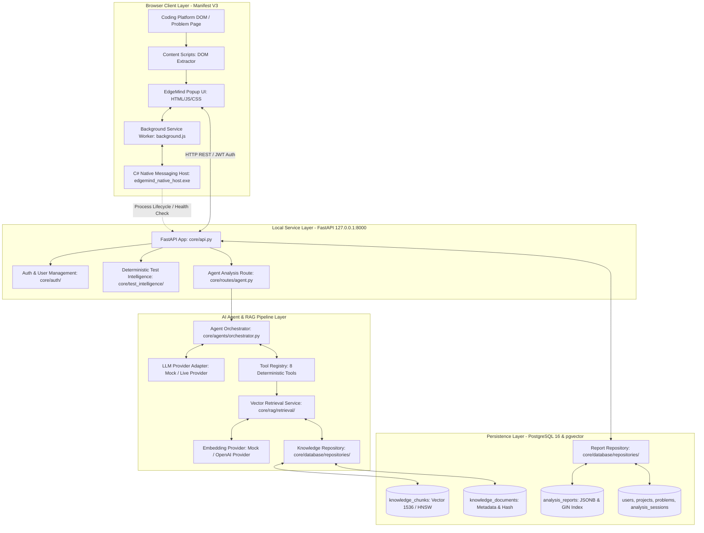
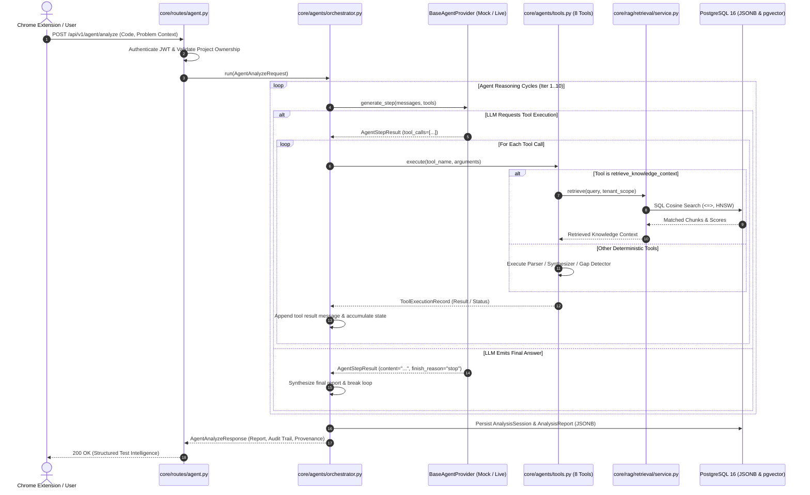
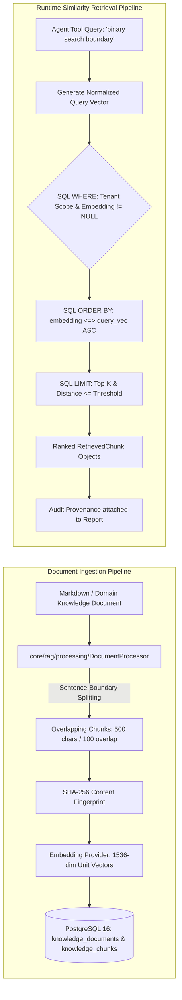
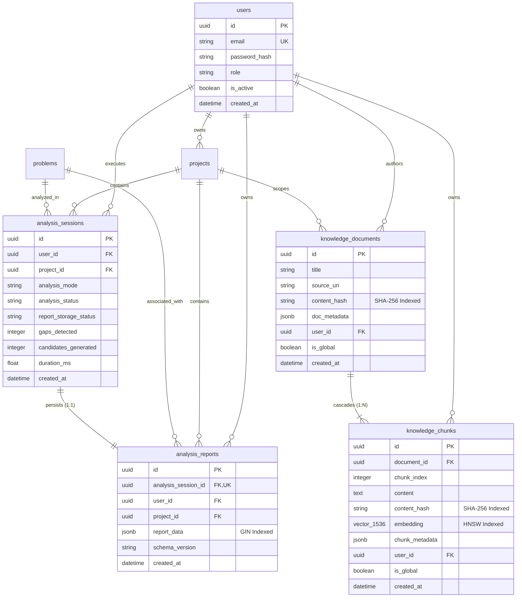

# EdgeMind — High-Level Design (HLD)

**Product:** EdgeMind — Adaptive Test Intelligence
**Release:** v1.0.0 (Assessment Evaluation Candidate)
**Document Status:** Complete Architecture & Implementation Baseline
**Repository:** https://github.com/whiskerwolf/EdgeMind

---

## 1. Introduction

This document details the high-level architecture of EdgeMind, an adaptive test intelligence system that assists software engineers and students in thoroughly testing algorithmic code. Delivered as a Manifest V3 Google Chrome extension backed by an asynchronous local FastAPI service, EdgeMind combines static code analysis, an autonomous multi-step AI agent, retrieval-augmented generation (RAG) over algorithmic reference data, and unified PostgreSQL 16 relational, JSONB, and pgvector storage.

---

## 2. Architecture Goals & Invariants

1. **Separation of Concerns**: Decouple browser DOM extraction, presentation, API orchestration, iterative AI reasoning, semantic vector search, and persistence.
2. **Zero Code Execution**: Maintain a strict static-only safety model (`static_only = True`). User-submitted code and synthesized test inputs are **never executed** (`eval()`, `exec()`, or subshells are forbidden).
3. **Truthfulness & Provenance**: Generated test candidates have unverified expected outputs (`expected_output = None`, `is_expected_output_verified = False`). Every retrieved RAG chunk and agent tool call is tracked in a structured audit trail.
4. **Locality & Privacy**: Bind the API strictly to loopback (`127.0.0.1:8000`). All user code, credentials, and tokens are scrubbed via `Settings.sanitize_error` before persistence or logging.
5. **Multi-Tenant Security**: Isolate user workspaces, projects, analysis sessions, reports, and private knowledge chunks using compound SQL predicates.
6. **Dialect Portability**: Target production PostgreSQL 16 with native JSONB GIN indexing and pgvector HNSW vector search, while providing a pure-Python SQLite fallback (`aiosqlite` with JSON) for zero-dependency CI testing.

---

## 3. Overall System Architecture

---

## 4. Component Architecture

### 4.1 Chrome Extension (`extension/edgemind/`)
- **Manifest V3 Architecture**: Adheres strictly to modern Chrome extension standards (`manifest.json`), eliminating persistent background pages in favor of an event-driven background service worker (`background.js`).
- **DOM Problem Extraction**: Detects supported problem pages (e.g. LeetCode), parsing problem title, difficulty, visible example inputs, parameter names, and programming language.
- **Resilient UI**: The popup displays backend connectivity, extracted constraints, detected coverage gaps, prioritized edge-case candidates, and static code quality metrics.
- **Safety Invariant UI**: Explicitly labels synthesized edge cases with a visible disclaimer confirming expected outputs are unverified.

### 4.2 Native Messaging Host (`scripts/`)
- **Lifecycle Bridge**: An unprivileged C# binary (`edgemind_native_host.exe`) registered in the Windows Registry (`HKCU\Software\Google\Chrome\NativeMessagingHosts\com.edgemind.native_host`).
- **Framing Protocol**: Communicates using Chrome's 4-byte little-endian length-prefixed JSON protocol over `stdin`/`stdout`.
- **Silent Lifecycle Management**: Launches the FastAPI backend silently via PowerShell scripts (`start_edgemind_api.ps1`) without flashing command prompt windows.
- **Graceful HTTP Fallback**: If Native Messaging is blocked by Windows Smart App Control (SAC) or enterprise policy, the extension automatically degrades to direct loopback HTTP polling (`http://127.0.0.1:8000/health`).

### 4.3 FastAPI Backend Service (`core/api.py`)
- Exposes structured REST endpoints on `127.0.0.1:8000` with CORS restricted to local dev servers and Chrome extension origins (`chrome-extension://*`).
- Structured sub-routers:
  - `/api/v1/auth`: Registration, login, token refresh, and logout.
  - `/api/v1/edgemind/analyze`: Fast deterministic static analysis and edge-case generation.
  - `/api/v1/agent/analyze`: Autonomous multi-step AI agent reasoning and tool orchestration.
  - `/api/v1/reports`: Paginated JSONB analysis report documents with tenant isolation.
  - `/api/v1/analyses`: Analysis session management and detailed subresources (`/candidates`, `/coverage-gaps`).
  - `/api/v1/projects`: Multi-tenant project workspace organization.

---

## 5. Multi-Step AI Agent Architecture

The multi-step AI agent (`core/agents/`) executes an iterative reasoning loop where an LLM evaluates problem constraints, plans investigative steps, invokes deterministic analysis tools, and synthesizes candidate test cases.

### 5.1 Tool Registry (`core/agents/tools.py`)
Encapsulates 8 isolated, deterministic functions with strict Pydantic argument schemas:
1. `parse_problem_constraints`: Extracts parameter bounds, array length limits, and character set invariants.
2. `analyze_problem_structure`: Analyzes AST structures, signatures, and input parameter mappings.
3. `detect_coverage_gaps`: Discovers omitted lower/upper bounds, zero/negative cases, and empty sets.
4. `generate_candidate_inputs`: Synthesizes candidate inputs for identified coverage gaps.
5. `rank_candidate_inputs`: Heuristically prioritizes candidates and prunes redundant test inputs.
6. `validate_candidate_inputs`: Classifies inputs into `VALID`, `ROBUSTNESS_PROBE`, or `CONSTRAINT_VALIDITY_UNKNOWN`.
7. `synthesize_edge_cases`: Executes combined boundary analysis and edge-case candidate generation.
8. `retrieve_knowledge_context`: Searches domain knowledge for algorithmic patterns and invariants via RAG.

---

## 6. Retrieval-Augmented Generation (RAG) Architecture

The RAG subsystem (`core/rag/`) bridges the gap between problem constraints and domain-specific edge-case patterns (e.g., binary search invariants, cycle detection traps, tree skewness).

### 6.1 Database-Side Vector Retrieval
- **pgvector Integration**: Uses the PostgreSQL `vector` extension (`Vector(1536)`).
- **Native Cosine Operator (`<=>`)**: Orders rows directly in SQL by cosine distance ($1 - \text{sim}$), returning closest chunks first.
- **HNSW Indexing**: Accelerated by a hierarchical navigable small-world index (`USING hnsw (embedding vector_cosine_ops)`).
- **Tenant Isolation Precedence**: Tenant isolation filters (`is_global IS true OR user_id = :user_id`) reside in the SQL `WHERE` clause and are evaluated **before** `ORDER BY` and `LIMIT`, preventing cross-tenant leakage.

---

## 7. Persistence Architecture: Relational, JSONB & pgvector

---

## 8. LLM Evaluation Framework

Located in `evaluation/`, the evaluation framework provides offline, quantitative benchmarks:
- **Datasets (`evaluation/datasets/`)**: 20 comprehensive algorithmic problems spanning binary search, two-pointer arrays, dynamic programming, trees, and graphs.
- **Metric Suite (`evaluation/metrics/`)**:
  - `ConstraintAccuracyMetric`: Precision and recall of extracted inequality bounds.
  - `ToolSelectionMetric`: Precision, recall, and F1-score of agent tool dispatch.
  - `EdgeCaseCoverageMetric`: Recall of critical boundary conditions identified against ground-truth sets.
  - `ResponseValidityMetric`: Verification that responses strictly conform to Pydantic schemas with unverified output disclaimers.
- **Runner (`evaluation/runner.py`)**: Executes deterministic CI runs using `MockAgentProvider` or optional live evaluations against external LLMs, persisting timestamped JSON evaluation reports.

---

## 9. Deployment View: Local Infrastructure vs. Cloud

### 9.1 Local Development & Evaluation (Current Implementation)
- **FastAPI Service**: Runs locally as an asynchronous Python process (`http://127.0.0.1:8000`).
- **Database Engine**: Containerized PostgreSQL 16 with `pgvector` managed via [docker-compose.yml](file:///c:/Users/DELL/Projects/EdgeMind/docker-compose.yml):
  - **Pinned Image**: `pgvector/pgvector:0.8.7-pg16` (Debian Bookworm base).
  - **Volume Isolation**: Dedicated volume `postgres_pgvector_data` isolates the Debian cluster from legacy `postgres_data` (Alpine) to avoid glibc/musl collation mismatches.
- **CI & Portable Testing**: When Docker is offline, the persistence layer utilizes an in-memory SQLite engine (`aiosqlite` with SQLite JSON), executing all unit tests and SQL compilation verifications without dependencies.

### 9.2 Cloud Deployment (Planned Future Scope — Not Implemented)
- Distributed container orchestration (Kubernetes / AWS ECS).
- Cloud-managed PostgreSQL (AWS RDS / GCP Cloud SQL with pgvector).
- Distributed cache layers (Redis cluster).
- External API Gateway with edge TLS termination and public rate limiting.
- *Status Note*: Cloud deployment is planned for future releases; all current functionality is implemented and verified for local workstation deployment.

---

## 10. Security & Safety Boundaries

1. **Loopback Binding**: The backend binds exclusively to `127.0.0.1`, rejecting inbound traffic from external networks.
2. **Zero Runtime Execution**: User code is analyzed exclusively using Python's `ast` module and static regex parsers; runtime execution is impossible.
3. **Prompt Injection Defense**: All retrieved RAG chunks are enclosed in `<retrieved_context>` tags with explicit system instructions prohibiting retrieved text from overriding core system rules.
4. **Input Size Limits**: User source code is capped at 64 KiB; RAG queries are capped at 2,000 characters; RAG chunk storage is capped at 4,000 characters.
5. **Credential & Secret Scrubbing**: All API keys, database connection strings, JWT secrets, and bearer tokens are redacted from logs and persisted reports via `Settings.sanitize_error`.
6. **Password Security**: Passwords are hashed with Argon2id; JWT access tokens expire in ~15 minutes; refresh tokens rotate on every use with automatic token family revocation upon reuse detection.
