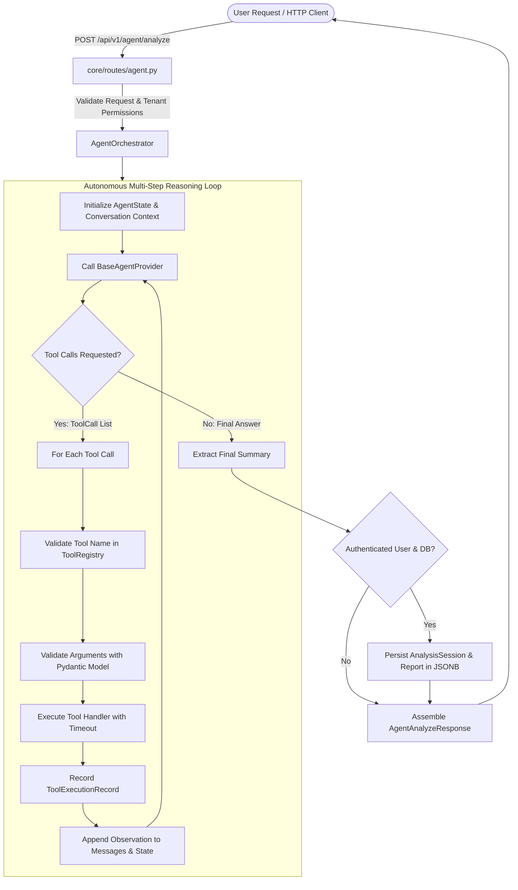

# EdgeMind Multi-Step AI Agent & Function Calling Architecture

**Module**: `core/agents/`  
**API Endpoint**: `POST /api/v1/agent/analyze`  
**Target Assessment Concepts**:
1. **Multi-Step Agent** (1.0 Potential Points)
2. **Function Calling / Tool Use** (0.3 Potential Points)

---

## 1. Executive Summary

EdgeMind introduces an autonomous, multi-step conversational reasoning agent designed for adaptive test intelligence and static code analysis. Unlike simplistic single-turn prompt chains or hardcoded sequential pipelines, EdgeMind's agent utilizes **native tool/function calling** governed by a stateful orchestration loop. 

The agent dynamically reasons about user-submitted code, inspects AST signatures, extracts constraint bounds, evaluates coverage gaps against input partitions, synthesizes targeted edge cases, validates them against mathematical domain invariants, ranks the candidates, and outputs an audit-trailed report.

### Key Architectural Highlights
- **Real Dynamic Function Calling**: The reasoning model autonomously decides which tools to invoke, with which arguments, and in what order based on intermediate observations.
- **7 Native Static Analytical Tools**: AST inspection, constraint parsing, gap evaluation, historical report retrieval, candidate synthesis, candidate validation, and candidate ranking.
- **Strict Static-Only Invariant**: User-submitted code and synthesized test inputs are **never executed at runtime** (`exec()`, `eval()`, and `subprocess` are completely absent). Analysis is purely static via Python AST parsing and deterministic domain algorithms.
- **Strict Provenance Guarantees**: All synthesized test candidates are explicitly tagged with `source="GENERATED_TEST"` and `expected_output=None`, eliminating false oracle claims.
- **Enterprise Governance & Safety**: Configurable loop bounds (`max_iterations`, `max_tool_calls`), per-tool timeout enforcement (`agent_tool_timeout`), request cancellation tokens, Pydantic argument validation, and multi-tenant project isolation.
- **PostgreSQL JSONB Integration**: Authenticated agent sessions automatically persist a complete analysis document with audit logs into EdgeMind's PostgreSQL JSONB repository.

---

## 2. Agent Architecture & Execution Lifecycle



---

## 3. Registered Tool Catalog (7 Analytical Tools)

All tools are registered in `core.agents.tools.ToolRegistry` and generate standard OpenAI/Gemini function calling schemas via Pydantic reflection (`model_json_schema()`):

| Tool Name | Purpose | Argument Model | Handler Guarantee |
| :--- | :--- | :--- | :--- |
| `parse_problem_constraints` | Extracts numerical/character bounds from LaTeX and natural language inequalities. | `ParseConstraintsArgs` | Never invents bounds; tracks unresolved constraints. |
| `analyze_problem_structure` | Statically inspects AST function signatures, parameter names, complexity, and smells. | `AnalyzeProblemStructureArgs` | Pure AST parsing with zero code execution. |
| `detect_coverage_gaps` | Identifies missing domain partitions (empty, zero, boundaries, extremes) in baseline tests. | `DetectCoverageGapsArgs` | Heuristic black-box input-domain partitioning. |
| `retrieve_existing_analysis` | Queries persistent database storage for prior reports and historical findings. | `RetrieveExistingAnalysisArgs` | Non-blocking query with fallback on disconnection. |
| `generate_candidate_inputs` | Synthesizes targeted edge-case candidate inputs addressing detected coverage gaps. | `GenerateCandidateInputsArgs` | Strict provenance: `GENERATED_TEST` with `expected_output=None`. |
| `validate_candidate_inputs` | Classifies candidates into `VALID`, `ROBUSTNESS_PROBE`, or `CONSTRAINT_VALIDITY_UNKNOWN`. | `ValidateCandidateInputsArgs` | Validates against extracted parameter invariants. |
| `rank_candidate_inputs` | Scores, deduplicates, and selects highest-value edge-case candidates. | `RankCandidateInputsArgs` | Deduplicates and penalizes redundant candidates. |

---

## 4. Multi-Step Orchestration & Error Recovery

The `AgentOrchestrator` (`core/agents/orchestrator.py`) manages the conversational turn lifecycle:

### Dynamic Tool Calling vs Hardcoded Pipeline
The agent does not blindly run every tool in a fixed sequence. The model inspects the initial context:
1. If constraints are provided in the problem context, it invokes `parse_problem_constraints`.
2. If test cases exist, it calls `detect_coverage_gaps` and `generate_candidate_inputs`.
3. If an invalid tool name or malformed parameter is emitted, the orchestrator returns an informative error message back to the conversation (`role="tool"`), allowing the agent to self-correct in the subsequent step.

### Safety Bounds & Governance
- **`max_iterations`**: Defaults to 5 (capped at 10). If the loop exhausts its budget, it terminates with `status="MAX_ITERATIONS_REACHED"` and synthesizes partial recommendations from accumulated findings.
- **`max_tool_calls`**: Enforces an upper limit (default 15) to prevent infinite execution loops or resource exhaustion.
- **`agent_tool_timeout`**: Default 10.0 seconds per tool execution via `asyncio.wait_for`.
- **`agent_session_timeout`**: Default 60.0 seconds total wall-clock time.
- **Cancellation Tokens**: Supports cooperative cancellation via `asyncio.Event`.

### Provider Availability & Robust Failure Handling
The system explicitly distinguishes between four operational execution states:

| Status (`AgentStatus`) | Execution Mode | `ai_reasoning_performed` | Description |
| :--- | :--- | :--- | :--- |
| **`SUCCESS`** | `AI_AGENT` | `True` | Live AI reasoning succeeded, with or without tool calls. |
| **`STATIC_ONLY`** | `STATIC_ONLY` | `False` | Explicit static-only mode; zero LLM calls attempted. |
| **`PROVIDER_UNAVAILABLE`** | `DEGRADED_STATIC` | `False` | No API key configured; zero tools claimed; useful static metrics preserved. |
| **`PROVIDER_ERROR`** | `DEGRADED_STATIC` | `False` | Provider HTTP error (401, 429, 500), timeout, network fail, or malformed JSON. |

- **No Silent Mock Fallback**: When `LiveAgentProvider` lacks credentials or fails, it never silently substitutes `MockAgentProvider`.
- **Degraded Static Preservation**: When external AI fails or is unconfigured, EdgeMind automatically executes its deterministic static AST analyzers and heuristic domain partition generators (`analyze_edgemind`) so the user still receives actionable code metrics and edge cases with full transparency.

---

## 5. REST API Integration (`POST /api/v1/agent/analyze`)

### Request Contract (`core/agents/schemas.py:AgentAnalyzeRequest`)
```json
{
  "code": "def twoSum(nums, target):\n    lookup = {}\n    for i, x in enumerate(nums):\n        if target - x in lookup:\n            return [lookup[target - x], i]\n        lookup[x] = i\n    return []",
  "filename": "solution.py",
  "mode": "agent",
  "problem_context": {
    "title": "Two Sum",
    "constraints": ["2 <= nums.length <= 10^4", "-10^9 <= nums[i] <= 10^9"]
  },
  "test_cases": [
    {"input_data": {"nums": [2, 7, 11, 15], "target": 9}}
  ],
  "max_iterations": 5,
  "max_candidates": 10,
  "static_only": true
}
```

### Response Contract (`core/agents/schemas.py:AgentAnalyzeResponse`)
```json
{
  "status": "SUCCESS",
  "product": "EdgeMind",
  "version": "1.0.0",
  "session_id": "9ce01af2-71fb-40ae-9326-0f7b52c7730d",
  "iterations": 5,
  "execution_mode": "AI_AGENT",
  "ai_reasoning_performed": true,
  "tool_executions": [
    {
      "tool_call_id": "call_1234abcd",
      "tool_name": "analyze_problem_structure",
      "arguments": { "code": "def twoSum..." },
      "status": "success",
      "duration_ms": 1.42,
      "result": { "function_name": "twoSum", "parameters": ["nums", "target"] }
    },
    {
      "tool_call_id": "call_5678efgh",
      "tool_name": "detect_coverage_gaps",
      "arguments": { "test_cases": [...] },
      "status": "success",
      "duration_ms": 2.15,
      "result": { "total_gaps": 4, "gaps": [...] }
    }
  ],
  "final_summary": "Analysis completed. Identified 4 boundary coverage gaps and synthesized 5 ranked test candidates.",
  "test_intelligence": {
    "existing_tests_analyzed": 1,
    "coverage_gaps": [...],
    "total_gaps": 4,
    "generated_candidates": [
      {
        "id": "gen_cand_1",
        "source": "GENERATED_TEST",
        "input_data": {"nums": [-1000000000, 1000000000], "target": 0},
        "expected_output": null,
        "is_expected_output_verified": false
      }
    ],
    "ranked_candidates": [...],
    "ranking_summary": { "total_evaluated": 10, "selection_limit": 5 }
  },
  "code_analysis": { ... },
  "total_duration_ms": 12.8,
  "persisted_report_id": "9ce01af2-71fb-40ae-9326-0f7b52c7730d"
}
```

### Multi-Tenancy & Project Isolation
If `project_id` is passed, the endpoint queries `ProjectRepository`:
1. If the project does not exist: returns HTTP 404.
2. If the user is unauthenticated or does not own the project (and is not an admin): returns HTTP 404 (preventing unauthorized ID enumeration).

---

## 6. Test Evidence & Automated Verification

The test suite in `tests/test_agent_orchestration.py` covers 27 comprehensive verification cases:

| Test Case | Scenario Verified | Status |
| :--- | :--- | :--- |
| `test_tool_registry_registration_and_schemas` | Dynamic tool registration and OpenAI/Gemini JSON Schema generation. | **PASSED** |
| `test_default_tool_registry_contains_7_analytical_tools` | Verifies all 7 analytical tools are registered by default. | **PASSED** |
| `test_tool_execution_timeout_isolated` | Registry aborts tools exceeding `timeout_seconds`. | **PASSED** |
| `test_single_tool_call_execution` | Single-turn tool invocation and observation handling. | **PASSED** |
| `test_multistep_sequential_tool_calling` | Real 4-tool sequence across 5 reasoning cycles. | **PASSED** |
| `test_direct_final_answer_termination` | Immediate final answer with zero tool calls exits in 1 iteration. | **PASSED** |
| `test_invalid_tool_name_rejection_and_recovery` | Unknown tool call returns error and agent self-corrects. | **PASSED** |
| `test_invalid_tool_arguments_validation_and_recovery` | Pydantic argument validation error and agent recovery. | **PASSED** |
| `test_tool_timeout_handling_in_orchestration` | Slow tool is marked TIMEOUT without crashing the agent. | **PASSED** |
| `test_maximum_iterations_bound` | Infinite tool-calling loop terminates at `max_iterations`. | **PASSED** |
| `test_request_cancellation` | Cooperative cancellation token sets `CANCELLED`. | **PASSED** |
| `test_zero_code_execution_security` | Submits destructive code; guarantees canary file is never created. | **PASSED** |
| `test_api_agent_analyze_endpoint_unauthenticated` | Unauthenticated access returns `PROVIDER_UNAVAILABLE` with static fallback. | **PASSED** |
| `test_api_agent_analyze_input_validations` | Enforces 64 KiB source code limit and rejects empty/non-static code. | **PASSED** |
| `test_api_agent_analyze_tenant_isolation` | Cross-tenant project ID manipulation returns HTTP 404. | **PASSED** |
| `test_api_agent_analyze_authenticated_persistence` | Full report persistence in PostgreSQL JSONB store. | **PASSED** |
| `test_api_agent_analyze_static_only_mode` | Explicit client request for `mode='static_only'` returns `STATIC_ONLY`. | **PASSED** |
| `test_live_provider_missing_api_key` | Unset key returns `PROVIDER_UNAVAILABLE`, zero tools called, static preserved. | **PASSED** |
| `test_live_provider_invalid_api_key_401` | HTTP 401 returns `PROVIDER_ERROR` and `authentication_error`. | **PASSED** |
| `test_live_provider_rate_limit_429` | HTTP 429 returns `PROVIDER_ERROR` and `rate_limit`. | **PASSED** |
| `test_live_provider_server_error_500` | HTTP 500 returns `PROVIDER_ERROR` and `server_error`. | **PASSED** |
| `test_live_provider_timeout` | Read timeout returns `PROVIDER_ERROR` and `timeout`. | **PASSED** |
| `test_live_provider_network_connection_failure` | Connect error returns `PROVIDER_ERROR` and `connection_error`. | **PASSED** |
| `test_live_provider_malformed_response` | HTML or corrupt JSON returns `PROVIDER_ERROR` and `malformed_response`. | **PASSED** |
| `test_live_provider_successful_response_parsing_mock_transport` | Valid OpenAI function calling JSON response parsed into typed ToolCalls. | **PASSED** |
| `test_live_provider_no_tool_call_response_handling` | Direct text completion sets `SUCCESS` with `ai_reasoning_performed=True`. | **PASSED** |
| `test_live_provider_multiple_tool_call_rounds` | Multi-turn tool calling sequence with stateful transport sets `SUCCESS`. | **PASSED** |

---

## 7. Viva Demonstration Guide

To demonstrate the Multi-Step AI Agent and Function Calling during evaluation:

### Step 1: Run Unit & Orchestration Tests
```powershell
.\.venv\Scripts\python.exe -m pytest tests/test_agent_orchestration.py -v
```
*Expected Result*: All 16 tests pass in ~1.0 second.

### Step 2: Demonstrate Interactive Multi-Step Agent Execution
Execute the scriptable multi-step reasoning flow in Python:
```powershell
.\.venv\Scripts\python.exe -c "
import asyncio
from core.agents import AgentOrchestrator, MockAgentProvider, AgentAnalyzeRequest, ToolCall, AgentStepResult

p = MockAgentProvider()
p.add_step(AgentStepResult(thought='Checking constraints', tool_calls=[ToolCall(name='parse_problem_constraints', arguments={'raw_constraints': ['1 <= nums.length <= 10^5']})]))
p.add_step(AgentStepResult(content='Finished analysis with verified bounds.'))

orchestrator = AgentOrchestrator(provider=p)
req = AgentAnalyzeRequest(code='def solution(nums):\n    return len(nums)')
res = asyncio.run(orchestrator.run(req))

print('Session ID:', res.session_id)
print('Status:', res.status)
print('Reasoning Iterations:', res.iterations)
print('Tool Executions:', [(t.tool_name, t.status, str(t.duration_ms) + 'ms') for t in res.tool_executions])
print('Summary:', res.final_summary)
"
```

### Step 3: Verify Zero Code Execution Security Guarantee
Demonstrate that malicious payloads submitted to the agent are never executed:
```powershell
.\.venv\Scripts\python.exe -c "
import asyncio
from pathlib import Path
from core.agents import AgentOrchestrator, MockAgentProvider, AgentAnalyzeRequest, ToolCall, AgentStepResult

canary = Path('hacked_demo.txt')
if canary.exists(): canary.unlink()

code = 'import os\nwith open(\"hacked_demo.txt\", \"w\") as f: f.write(\"PWNED\")\nos.system(\"calc.exe\")'

p = MockAgentProvider()
p.add_step(AgentStepResult(tool_calls=[ToolCall(name='analyze_problem_structure', arguments={'code': code})]))
p.add_step(AgentStepResult(content='AST inspected safely.'))

o = AgentOrchestrator(provider=p)
res = asyncio.run(o.run(AgentAnalyzeRequest(code=code)))

print('Canary File Created?:', canary.exists())
assert not canary.exists(), 'SECURITY BREACH'
print('Security Assertion Passed: Zero code execution confirmed.')
"
```
