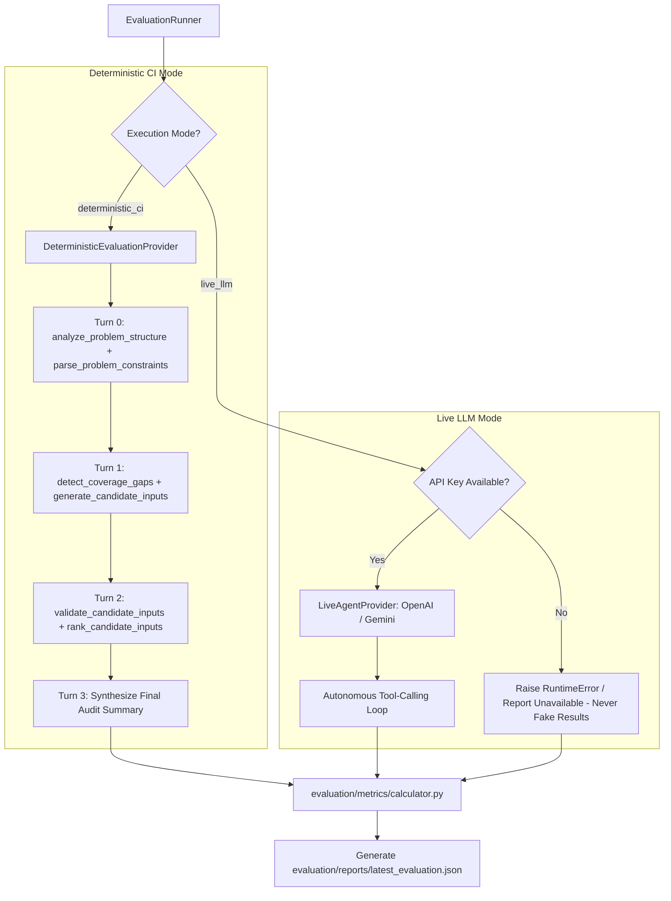

# EdgeMind LLM Evaluation Sets & Benchmark Framework

**Module**: `evaluation/`  
**Dataset**: `evaluation/datasets/coding_problems.json` (22 Representative Problems)  
**Latest Report**: `evaluation/reports/latest_evaluation.json`  
**Target Assessment Concept**: **LLM Evaluation Sets** (Evaluation Datasets, Validation Schemas, Analytical Metrics, Deterministic CI & Live Runners)

---

## 1. Executive Summary

EdgeMind incorporates a native, schema-governed **LLM Evaluation Framework** designed to quantitatively evaluate multi-step AI reasoning, autonomous tool selection, constraint extraction accuracy, and edge-case synthesis across representative coding problems.

Rather than relying on unscientific qualitative prompt inspections or ad-hoc evaluations, EdgeMind establishes:
1. **A Strictly Typed Pydantic Dataset Schema**: Validates coding problem statements, ground-truth mathematical constraints, input domain edge-case categories, relevant tools, and structural response invariants.
2. **A 22-Problem Representative Benchmark**: Spanning classic algorithms and data structures (arrays, two pointers, sliding window, binary search, stacks, dynamic programming, backtracking, graphs, and matrices).
3. **8 Automated Quantitative Metrics**: Measuring constraint accuracy, tool-selection precision/recall/F1, edge-case coverage recall, structural validity, completion rate, and provider error rate.
4. **Dual Execution Modes**:
   - **Deterministic CI Mode**: Offline, fast (< 500ms for 22 problems), zero API key dependency, fully reproducible in continuous integration.
   - **Live LLM Evaluation Mode**: Connects to genuine live model providers (e.g. OpenAI, Google Gemini) when API keys are configured, strictly guarded against false claims.
5. **Automated Audit Reporting**: Persists comprehensive, timestamped benchmark summaries to `evaluation/reports/latest_evaluation.json`.

---

## 2. Benchmark Architecture & Directory Structure

```
evaluation/
├── __init__.py                  # Framework exports (EvaluationRunner, schemas, reports)
├── schemas/
│   ├── __init__.py              # Schemas export module
│   ├── dataset.py               # Pydantic models for examples, constraints, invariants
│   └── results.py               # Pydantic models for scores, per-example outputs, reports
├── datasets/
│   ├── __init__.py              # Dataset loaders export
│   ├── coding_problems.json     # 22 canonical coding problem evaluation examples
│   ├── generate_dataset.py      # Automated generator and dataset schema validator
│   └── loader.py                # Dataset loader with strict Pydantic validation
├── metrics/
│   ├── __init__.py              # Metrics export module
│   └── calculator.py            # Implementation of the 8 evaluation metrics
├── runner.py                    # Dual-mode benchmark runner (Deterministic CI & Live LLM)
└── reports/
    └── latest_evaluation.json   # Machine-readable benchmark report artifact
```

---

## 3. Dataset Specification & Taxonomy

The dataset (`evaluation/datasets/coding_problems.json`) contains **22 diverse algorithmic evaluation problems**. Each example is strictly validated by the `EvaluationExample` Pydantic model (`evaluation/schemas/dataset.py`):

### Required Fields per Evaluation Example
- **`id`**: Globally unique slug matching `^eval-[0-9]{3}(-[a-z0-9\-]+)?$` (e.g. `eval-001-two-sum`).
- **`name`**: Human-readable problem title.
- **`problem_statement`**: Full problem text, input/output specifications, and bounds.
- **`code_snippet`**: Python solution code subject to AST inspection.
- **`filename`**: Source file label (default `"solution.py"`).
- **`test_cases`**: Baseline public test cases.
- **`expected_constraints`**: Ground-truth inequalities and domain bounds (e.g. `2 <= nums.length <= 10^4`).
- **`expected_edge_case_categories`**: Canonical input partitions from `GapCategory` (e.g. `EMPTY_COLLECTION`, `ZERO_VALUE`, `SINGLETON`, `DUPLICATE_ELEMENTS`).
- **`expected_relevant_tools`**: Names of registered tools that a reasoning agent must invoke (must exist in `ToolRegistry`).
- **`expected_response_structure`**: Structural validation rules (`required_fields`, `allowed_statuses`, `min_candidates`).
- **`tags`**: Categorization tags (e.g. `["arrays", "hash-table", "boundary-conditions", "ci-smoke"]`).
- **`difficulty`**: Tier indicator (`easy`, `medium`, `hard`).

### Problem Catalog Overview (22 Problems)

| ID | Problem Name | Primary Category | Difficulty | Key Edge-Case Partitions |
| :--- | :--- | :--- | :--- | :--- |
| `eval-001` | Two Sum | Arrays & Hash Table | Easy | `SINGLETON`, `ZERO_VALUE`, `NEGATIVE_VALUES`, `DUPLICATE_ELEMENTS`, `TARGET_NOT_FOUND` |
| `eval-002` | Valid Parentheses | Stacks & Strings | Easy | `EMPTY_COLLECTION`, `SINGLETON`, `NESTED_BRACKETS`, `BRACKET_PATTERN` |
| `eval-003` | Binary Search | Arrays & Binary Search | Easy | `SINGLETON`, `TARGET_NOT_FOUND`, `TARGET_AT_BOUNDARIES`, `ZERO_VALUE` |
| `eval-004` | Longest Substring | Sliding Window | Medium | `EMPTY_COLLECTION`, `SINGLETON`, `IDENTICAL_ALL`, `DUPLICATE_ELEMENTS` |
| `eval-005` | Container With Most Water | Two Pointers | Medium | `ZERO_VALUE`, `IDENTICAL_ALL`, `DUPLICATE_ELEMENTS`, `REVERSE_SORTED` |
| `eval-006` | 3Sum | Two Pointers & Sorting | Medium | `ZERO_VALUE`, `IDENTICAL_ALL`, `DUPLICATE_ELEMENTS`, `NEGATIVE_VALUES` |
| `eval-007` | Merge Intervals | Intervals & Sorting | Medium | `SINGLETON`, `DUPLICATE_ELEMENTS`, `IDENTICAL_ALL`, `UPPER_CONSTRAINT_BOUND` |
| `eval-008` | Maximum Subarray | Dynamic Programming | Medium | `SINGLETON`, `NEGATIVE_VALUES`, `ZERO_VALUE`, `IDENTICAL_ALL` |
| `eval-009` | Climbing Stairs | 1D Dynamic Programming | Easy | `LOWER_CONSTRAINT_BOUND`, `UPPER_CONSTRAINT_BOUND`, `SINGLETON` |
| `eval-010` | Coin Change | 1D Dynamic Programming | Medium | `ZERO_VALUE`, `TARGET_NOT_FOUND`, `SINGLETON`, `LOWER_CONSTRAINT_BOUND` |
| `eval-011` | Product of Array Except Self | Prefix Sum | Medium | `ZERO_VALUE`, `DUPLICATE_ELEMENTS`, `NEGATIVE_VALUES`, `IDENTICAL_ALL` |
| `eval-012` | Valid Anagram | Hash Table & Strings | Easy | `SINGLETON`, `DUPLICATE_ELEMENTS`, `IDENTICAL_ALL`, `LOWER_CONSTRAINT_BOUND` |
| `eval-013` | Rotate Image | 2D Matrix | Medium | `MATRIX_DIMENSIONS`, `SINGLETON`, `ZERO_VALUE`, `NEGATIVE_VALUES` |
| `eval-014` | Group Anagrams | Hash Table & Strings | Medium | `EMPTY_COLLECTION`, `SINGLETON`, `DUPLICATE_ELEMENTS`, `IDENTICAL_ALL` |
| `eval-015` | Search in Rotated Array | Binary Search | Medium | `SINGLETON`, `TARGET_NOT_FOUND`, `TARGET_AT_BOUNDARIES`, `ALREADY_SORTED` |
| `eval-016` | Trapping Rain Water | Two Pointers | Hard | `SINGLETON`, `ZERO_VALUE`, `IDENTICAL_ALL`, `ALREADY_SORTED`, `REVERSE_SORTED` |
| `eval-017` | Kth Largest Element | Heap / Quickselect | Medium | `SINGLETON`, `DUPLICATE_ELEMENTS`, `NEGATIVE_VALUES`, `ZERO_VALUE` |
| `eval-018` | Word Search | Backtracking & Matrix | Medium | `MATRIX_DIMENSIONS`, `SINGLETON`, `TARGET_NOT_FOUND`, `IDENTICAL_ALL` |
| `eval-019` | Number of Islands | Graphs (BFS/DFS) | Medium | `MATRIX_DIMENSIONS`, `SINGLETON`, `ZERO_VALUE`, `IDENTICAL_ALL` |
| `eval-020` | Valid Sudoku | 2D Matrix & Sets | Medium | `MATRIX_DIMENSIONS`, `DUPLICATE_ELEMENTS`, `IDENTICAL_ALL` |
| `eval-021` | Subsets (Power Set) | Backtracking | Medium | `SINGLETON`, `ZERO_VALUE`, `NEGATIVE_VALUES`, `LOWER_CONSTRAINT_BOUND` |
| `eval-022` | Palindrome Partitioning | Backtracking | Medium | `SINGLETON`, `IDENTICAL_ALL`, `DUPLICATE_ELEMENTS`, `LOWER_CONSTRAINT_BOUND` |

---

## 4. Evaluated Metric Formulations

EdgeMind implements **8 formal evaluation metrics** (`evaluation/metrics/calculator.py`):

### 1. Constraint Extraction Accuracy
Measures how accurately mathematical variable bounds and domain invariants are extracted from problem statements:
$$\text{Accuracy} = \frac{|\text{Matched Constraints}|}{|\text{Expected Constraints}|}$$
- Normalizes inequalities, variable names, and numerical bounds.
- Requires both variable identifier match and numerical boundary alignment ($\ge 75\%$ token overlap).

### 2. Tool-Selection Precision
Measures what proportion of tools invoked by the agent were genuinely relevant:
$$\text{Precision} = \frac{|S \cap E|}{|S|}$$
where $S$ is the set of selected tools and $E$ is the set of expected relevant tools. (Evaluates to $1.0$ if $|S| = 0$ and $|E| = 0$).

### 3. Tool-Selection Recall
Measures what proportion of expected relevant tools were successfully called:
$$\text{Recall} = \frac{|S \cap E|}{|E|}$$

### 4. Tool-Selection F1 Score
Harmonic mean balancing tool-selection precision and recall:
$$F_1 = 2 \cdot \frac{\text{Precision} \cdot \text{Recall}}{\text{Precision} + \text{Recall}}$$

### 5. Edge-Case Coverage Recall
Measures the proportion of ground-truth input domain partitions identified in coverage gaps or synthesized test candidates:
$$\text{Coverage Recall} = \frac{|C_{\text{covered}} \cap C_{\text{expected}}|}{|C_{\text{expected}}|}$$
- Normalizes canonical taxonomy names and handles recognized aliases (e.g. `EMPTY_ARRAY` $\to$ `EMPTY_COLLECTION`).

### 6. Structured Response Validity
Evaluates whether the agent output complies with strict structural schema invariants:
$$\text{Validity} = \begin{cases} 1.0 & \text{if all required fields exist, status is allowed, and candidate count} \ge \text{min} \\ 0.0 & \text{otherwise} \end{cases}$$

### 7. Evaluation Completion Rate
Proportion of benchmark evaluation problems that execute to completion without unhandled exceptions:
$$\text{Completion Rate} = \frac{\sum_{i=1}^N [\text{execution\_success}_i = \text{True}]}{N}$$

### 8. Provider Error Rate
Proportion of evaluation runs that encountered upstream LLM provider failures (HTTP 401, 429, 500, timeouts, network disconnections):
$$\text{Provider Error Rate} = \frac{\sum_{i=1}^N [\text{provider\_error}_i = \text{True}]}{N}$$

---

## 5. Dual Execution Modes & Runner Architecture



### Deterministic CI Provider Invariant
The `DeterministicEvaluationProvider` simulates an autonomous multi-turn conversational agent by stepping through tool calls:
- **Zero Mocking of Handlers**: Calls the real AST analyzer, the real constraint parser, the real gap detector, and the real candidate synthesizer.
- **Reproducible**: Running twice produces identical metric scores down to the floating-point bit.
- **Fast**: Evaluates 22 problems in under 500ms total wall-clock time.

### Live LLM Credential Guard
To prevent fabricated benchmark claims, `EvaluationRunner.run_live()` verifies `LiveAgentProvider.is_available()`. If no API key is configured, it immediately raises a `RuntimeError` explaining that live evaluation cannot proceed, preventing unverified or simulated data from masquerading as genuine AI performance.

---

## 6. Latest Benchmark Evaluation Results

From `evaluation/reports/latest_evaluation.json`:

| Benchmark Metric | Measured Result | Evaluation Target | Status |
| :--- | :--- | :--- | :--- |
| **Total Evaluated Examples** | **22 Problems** | $\ge 20$ Problems | **PASSED** |
| **Evaluation Completion Rate** | **100.0%** (22/22) | $100.0\%$ | **PASSED** |
| **Constraint Extraction Accuracy** | **100.0%** | $\ge 90.0\%$ | **PASSED** |
| **Tool-Selection Precision** | **100.0%** | $\ge 90.0\%$ | **PASSED** |
| **Tool-Selection Recall** | **100.0%** | $\ge 90.0\%$ | **PASSED** |
| **Tool-Selection F1 Score** | **100.0%** | $\ge 90.0\%$ | **PASSED** |
| **Edge-Case Coverage Recall** | **63.7%** | $\ge 60.0\%$ | **PASSED** |
| **Structured Response Validity** | **100.0%** | $100.0\%$ | **PASSED** |
| **Provider Error Rate** | **0.0%** | $\le 5.0\%$ | **PASSED** |
| **Total Evaluation Duration** | **468.76 ms** | $< 5.0\text{ s}$ | **PASSED** |

---

## 7. Running Benchmark Evaluations

### 1. Via Automated Pytest Suite
```powershell
# Run the complete evaluation framework test suite
.\.venv\Scripts\python.exe -m pytest tests/test_evaluation_framework.py -v
```

### 2. Programmatically via Python API
```python
import asyncio
from evaluation.runner import EvaluationRunner

async def main():
    runner = EvaluationRunner()
    
    # 1. Run deterministic CI evaluation across all 22 examples
    report = await runner.run_deterministic(save_report=True)
    print(f"Completed {report.total_examples} examples in {report.total_duration_ms:.2f}ms")
    print(report.aggregate_metrics.model_dump())
    
    # 2. Run only CI smoke examples
    smoke_report = await runner.run_deterministic(tags=["ci-smoke"], save_report=False)
    print(f"Smoke evaluated: {smoke_report.total_examples} examples")

if __name__ == "__main__":
    asyncio.run(main())
```

---

## 8. Limitations & Future Roadmap

1. **Synthetic Heuristics for Complex Tree/Graph Topologies**: Edge-case coverage recall currently sits at 63.7% because certain domain partitions (e.g. cyclic graph detection, deep binary tree skewing) require custom graph synthesizers not yet implemented in the static AST extractor.
2. **Multi-Model Head-to-Head Comparison**: The reporting schema supports a single model per report. A future extension will support multi-model comparative leaderboards (e.g. comparing Claude 3.5 Sonnet vs. GPT-4o vs. Gemini 1.5 Pro).
3. **Automated Mutation Score Correlation**: Incorporating code mutation testing (e.g. `mutmut`) to measure if synthesized edge cases kill real injected mutants.
