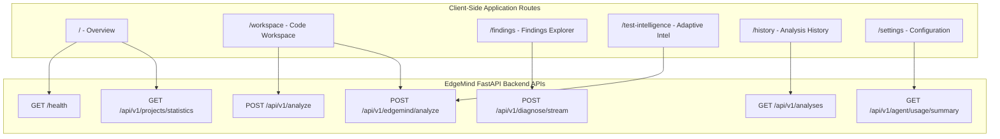

# EdgeMind Web Dashboard: UI/UX Design Research & Visual Architecture Specification

**Project**: EdgeMind Developer Intelligence Platform  
**Phase**: 6.2 - Premium Dashboard Design Research  
**Document**: `docs/dashboard/DESIGN_RESEARCH.md`  
**Date**: November 2026  
**Status**: APPROVED REFERENCE ARCHITECTURE  

---

## 1. Executive Summary

This research document defines the design direction, visual identity, interaction paradigms, and component architecture for the **EdgeMind Web Dashboard**. 

EdgeMind is an advanced developer intelligence workspace featuring:
- Deterministic static Python code analysis (AST-based, zero runtime execution)
- Code quality, complexity, and smell detection
- Adaptive Test Intelligence (coverage gap evaluation & boundary candidate synthesis)
- Real-time finding-level AI diagnosis streaming over Server-Sent Events (SSE)
- Dual backend execution modes: in-memory stateless analysis and PostgreSQL-backed session persistence

The primary objective of this research is to ensure that the EdgeMind Web Dashboard looks and feels like a **polished, high-performance, precision engineering workspace** crafted by an elite developer tools team. It must completely avoid generic, template-based, or AI-generated aesthetics (such as glowing neon gradients, purposeless glassmorphism, decorative charts, or empty padding). Instead, EdgeMind synthesizes the finest attributes of industry-defining developer interfaces—**Linear's** tonal depth and interaction density, **Vercel's** typographic discipline and monochromatic restraint, **Sentry's** structured diagnostic data streams, **Raycast's** keyboard-first efficiency, and **PostHog's** clear analytical visualization.

This document serves as the mandatory reference specification for all Phase 6 implementation phases.

---

## 2. Research Methodology

To establish an authoritative design foundation, research was executed through three investigative tracks:

1. **Direct Interface & Architecture Analysis**:
   - Analyzed primary references: **Linear** (issue tracking & task hierarchy), **Vercel / Geist** (developer deployment & analytics console), **Sentry** (issue stream, stack trace, and severity inspection), **Raycast** (keyboard-first desktop utility & action panels), and **PostHog** (product & error analytics dashboards).
   - Analyzed secondary references: **Stripe** (dense financial tables & numeric alignment), **Supabase Studio** (dark developer console & database grid), and **GitHub Primer** (code review, diff split-views, and status indicators).
2. **Design Token & Source Code Deconstruction**:
   - Examined public design system specifications, CSS variable declarations, open-source repositories, and design token architectures (e.g., Geist design tokens, Linear CSS color tokens, Primer layout primitives).
3. **EdgeMind Codebase Integration Mapping**:
   - Mapped all design concepts directly to EdgeMind's audited backend API schema ([core/schemas.py](file:///c:/Users/DELL/Projects/EdgeMind/core/schemas.py)), models ([core/models.py](file:///c:/Users/DELL/Projects/EdgeMind/core/models.py)), and TypeScript contracts ([extension/vscode/src/types/api.ts](file:///c:/Users/DELL/Projects/EdgeMind/extension/vscode/src/types/api.ts)).
   - Guaranteed that every metric, card, table column, and status indicator reflects verified backend data models without inventing fabricated metrics or non-existent telemetry.

---

## 3. Product Reference Analysis

### 3.1 Primary References

#### A. Linear
- **Sidebar & Navigation**: Fixed left-hand vertical rail (240px expanded, 60px collapsed). Workspaces and teams grouped logically with small, crisp SVG icons. Active navigation indicated by subtle background tint (`rgba(255, 255, 255, 0.08)`) and high-contrast text rather than colored accents.
- **Surface Elevation Hierarchy**: Dark-mode native. Linear rejects pure pitch black (`#000000`) for canvases in favor of deep obsidian with subtle cool undertones:
  - Base Canvas: `#08090A`
  - Panel / Sidebar: `#0F1011`
  - Elevated Tile / Card: `#141516`
  - Floating Menu / Modal: `#191A1B`
- **Hairline Dividers**: Replaces heavy drop shadows with 1px translucent borders (`rgba(255, 255, 255, 0.05)` to `0.08`), creating razor-sharp structural boundaries.
- **Typography & Interaction Density**: Utilizes Inter Variable with a signature medium weight `510` and aggressive negative letter-spacing on display headings (`-0.03em`). Dense lists display status, priority, ID, title, and assignee in a single 36px horizontal row.
- **Hover & Motion**: Row hover states apply a subtle 100ms surface shift (`#141516`), instantly surfacing contextual action buttons (copy, assign, status toggle).

#### B. Vercel (Geist Design System)
- **Monochromatic Restraint**: 95% of the UI is carried by grayscale luminance (pure white, stepped grays, deep black). Color is strictly functional (status dots, active focus rings).
- **Typography**: Geist Sans for UI text; Geist Mono strictly employed for commit hashes, paths, timestamps, tabular figures, and code snippets. Font weight caps at `600` (semibold); `700`+ weights are avoided.
- **4px Metric Grid**: Strict adherence to a 4px/8px layout grid (`space-1`: 4px, `space-2`: 8px, `space-4`: 16px, `space-6`: 24px).
- **Border Shadows**: Utilizes `box-shadow: 0 0 0 1px var(--border)` instead of standard `border` declarations to prevent fractional subpixel clipping and layout jitter.
- **Status Indicators**: Micro status dots (8px–10px) with subtle ambient rings rather than full-width saturated banner backgrounds.

#### C. Sentry
- **Issue Stream & Filter Bar**: Single integrated filter input combining free-text search with tokenized key-value filter pills (e.g., `is:error`, `rule:ZeroDivisionError`, `line:2`).
- **Severity Encoding**: Visual hierarchy strictly differentiated by semantic color and iconography:
  - Fatal/Error: Red (`#EF4444`)
  - Warning: Amber (`#F59E0B`)
  - Info: Blue/Sky (`#38BDF8`)
- **Breadcrumb & Detail Drawer**: Avoids nested scroll containers. Drill-down details render in a wide, responsive side drawer or full split-pane with sticky diagnostic metadata headers.

#### D. Raycast
- **Keyboard-First Ergonomics**: Global search and action invocation via `Cmd+K`. Navigation entirely controllable via arrow keys, `Tab`, `Enter`, and `Escape`.
- **Action Bar Footer**: Persistent, ultra-compact bottom action bar displaying the primary action (`Enter: Run Analysis`) alongside secondary action panel access (`Cmd+K: Actions`).
- **Monospaced Keyboard Badges**: Keycaps (`⌘`, `↵`, `Esc`) rendered as distinct monospaced micro-badges (`kbd` tags with `1px` subtle borders) that teach power-user shortcuts continuously.

#### E. PostHog
- **Analytical Clarity**: Dashboards utilize structured metric cards showing value, unit, and delta without visual clutter.
- **Dense Data Tables**: Column headers support instant sorting, monospace tabular alignment, and horizontal scrolling contained strictly within the table body rather than breaking page bounds.

---

### 3.2 Secondary References

- **Stripe**: Tabular numerals (`font-variant-numeric: tabular-nums`) across all score counters and line numbers. High-contrast typography with explicit label-value pairings.
- **Supabase Studio**: Multi-pane split architecture with a collapsible table/file explorer on the left, primary editor/data grid in the center, and contextual detail inspector on the right.
- **GitHub Primer**: Split code diffs, sticky line-number gutters, and clean tag counters (`12 issues`, `4 warnings`) with pill borders.

---

## 4. Design Patterns to Avoid (Anti-Patterns)

EdgeMind explicitly bans the following generic "AI template" and amateur developer dashboard tropes:

| Anti-Pattern | Why It Degrades Developer Trust | EdgeMind Enforced Alternative |
| :--- | :--- | :--- |
| **Excessive Mesh Gradients & Glows** | Screams "AI wrapper landing page"; reduces text contrast and strains eyes during long coding sessions. | Solid obsidian canvas (`#090A0F`) with stepped surface luminance and razor-thin hairline borders. |
| **Glassmorphism Everywhere (`backdrop-blur`)** | Blurry semi-transparent cards cause visual noise, reduce text legibility, and degrade GPU rendering speed. | Opaque solid surface panels with distinct border tokens (`#1E2235`). Glassmorphism restricted strictly to sticky nav bars. |
| **Generic Purple / Magenta Aesthetic** | Cliché template palette derived from consumer AI chatbots; unsuited for precision developer tooling. | Technical **Deep Indigo / Electric Cyan** brand mark paired with a restrained slate-monochrome interface. |
| **Emojis in Production UI** | Using 🚀, ✨, 🧠, 💥 in navigation, headers, or finding titles feels playful and amateurish. | Production-grade SVG icons from **Lucide React** (16px/18px stroke, 1.75px stroke width). |
| **Fabricated Metrics & "Fake Trends"** | Displaying "+14% vs last week" or arbitrary health gauges when the backend does not collect telemetry. | Only display real, verified backend outputs (exact score 0–100, error counts, line numbers, latency ms). |
| **Oversized Marketing Headings** | Display titles (`text-5xl`) consuming 30% of viewport height on data-intensive workspaces. | Compact developer hierarchy (`text-lg` for page titles, `text-sm` for section headers, `text-xs` for metadata). |
| **Low-Density Floating Cards** | Huge 32px padding on cards displaying single findings, forcing endless vertical scrolling. | High-density tables and list items (36px–44px row heights) with compact 12px–16px card padding. |
| **Distracting Motion & Bouncy Springs** | Cards animating in from all directions whenever an analysis runs disorients the engineer. | Instantaneous DOM updates or subtle 150ms opacity/transform transitions. Complete `prefers-reduced-motion` support. |

---

## 5. EdgeMind Visual Identity & Design Direction

### 5.1 Product Metaphor: "The Precision Developer Intelligence Workspace"
EdgeMind is designed as a high-density, mission-critical instrument—combining the speed of a native code editor with the diagnostic depth of an enterprise static analysis suite.

### 5.2 Atmosphere & Surface Ladder
Dark-mode first, built on a cool obsidian slate architecture:

```css
:root {
  /* Canvas & Base Surfaces */
  --em-canvas:          #090A0F;  /* Deepest viewport floor */
  --em-surface-1:       #0D0E15;  /* Sidebar, header, panel containers */
  --em-surface-2:       #12141F;  /* Cards, workspace tiles, editor gutter */
  --em-surface-3:       #171927;  /* Dropdowns, elevated popovers, active rows */
  --em-surface-4:       #1D2032;  /* Tooltips, floating modals, dragged states */

  /* Hairlines & Borders */
  --em-border-subtle:   rgba(255, 255, 255, 0.06); /* Grid lines, subtle row dividers */
  --em-border-default:  #1E2235;                   /* Standard card & container borders */
  --em-border-strong:   #2C324E;                   /* Hovered borders, active inputs */
  --em-border-focus:    #38BDF8;                   /* Keyboard focus ring (Sky-400) */

  /* Text & Ink Tokens */
  --em-text-primary:    #F8FAFC;  /* High-contrast headings and primary code */
  --em-text-secondary:  #CBD5E1;  /* Body descriptions, card content */
  --em-text-muted:      #94A3B8;  /* Labels, table headers, breadcrumbs */
  --em-text-dim:        #64748B;  /* Line numbers, disabled text, hotkeys */

  /* Interactive Brand Accents */
  --em-brand-cyan:      #38BDF8;  /* Electric Cyan / Sky 400 */
  --em-brand-indigo:    #818CF8;  /* Indigo 400 */
  --em-brand-gradient:  linear-gradient(135deg, #38BDF8 0%, #818CF8 100%);
  --em-brand-glow:      rgba(56, 189, 248, 0.15);
}
```

### 5.3 Semantic Diagnostic Tokens
Directly mapped to `core/analyzer.py` and `core/json_reporter.py`:

```css
:root {
  /* Error (SyntaxError, ZeroDivisionError, NameError, LogicError) */
  --em-status-error:          #EF4444;
  --em-status-error-bg:       rgba(239, 68, 68, 0.08);
  --em-status-error-border:   rgba(239, 68, 68, 0.25);

  /* Warning (HighComplexity, UnusedVariable, DeepNesting, CodeSmells) */
  --em-status-warning:        #F59E0B;
  --em-status-warning-bg:     rgba(245, 158, 11, 0.08);
  --em-status-warning-border: rgba(245, 158, 11, 0.25);

  /* Info / Adaptive Intelligence / Baseline */
  --em-status-info:           #38BDF8;
  --em-status-info-bg:        rgba(56, 189, 248, 0.08);
  --em-status-info-border:    rgba(56, 189, 248, 0.25);

  /* Pass / Success / Valid Candidate */
  --em-status-success:        #10B981;
  --em-status-success-bg:     rgba(16, 185, 129, 0.08);
  --em-status-success-border: rgba(16, 185, 129, 0.25);
}
```

---

## 6. Typography System Recommendations

### 6.1 Font Stacks
1. **Primary Interface Font**: `Inter Variable, -apple-system, BlinkMacSystemFont, "Segoe UI", Roboto, sans-serif`
   - Feature flags: `font-feature-settings: "cv01" 1, "cv02" 1, "cv11" 1, "ss01" 1;`
   - Yields clean developer typography with distinct capital `I`, numeric `1`, and curved lowercase `l`.
2. **Code, Telemetry & Numeric Tabular Font**: `JetBrains Mono, Geist Mono, Menlo, Monaco, Consolas, monospace`
   - Feature flags: `font-variant-numeric: tabular-nums;`
   - Guarantees exact columnar alignment of line numbers, scores, latency values, and byte sizes.

### 6.2 Typographic Hierarchy Scale

| Token | Size | Weight | Line Height | Tracking | Application |
| :--- | :--- | :--- | :--- | :--- | :--- |
| `display-lg` | 24px (1.5rem) | 600 (Semibold) | 32px | -0.025em | Workspace primary title, Overview greeting |
| `heading-md` | 18px (1.125rem) | 600 (Semibold) | 24px | -0.02em | Section headers, modal titles, panel headers |
| `heading-sm` | 14px (0.875rem) | 600 (Semibold) | 20px | -0.015em | Card headers, sidebar group titles, finding rules |
| `body-default` | 13px (0.8125rem) | 400 (Regular) | 18px | 0 | Diagnostic messages, finding explanations, help text |
| `body-medium` | 13px (0.8125rem) | 500 (Medium) | 18px | 0 | Interactive labels, tab titles, table rows |
| `caption-sm` | 11px (0.6875rem) | 500 (Medium) | 14px | +0.02em | Metadata badges, line badges, category tags |
| `mono-code` | 12.5px | 400 (Regular) | 18px | 0 | Monaco code editor, snippet context, AST variables |
| `mono-tabular`| 12px | 500 (Medium) | 16px | 0 | Latency (14.2ms), scores (80/100), timestamps |

---

## 7. Layout Principles & Spatial Grid

### 7.1 Multi-Pane Workspace Architecture
EdgeMind employs an asymmetrical split-pane layout modeled on modern IDEs and Sentry's issue console:

```
+---------------------------------------------------------------------------------------------------------+
| [Brand Lockup] EdgeMind    [Workspace / Analysis Title]    [Latency / Health Pill]  [Analyze ↵] [Docs]  |
+---------+---------------------------------------------------+-------------------------------------------+
| Nav     | Code Editor Workspace                             | Diagnostic Findings & Adaptive Intel      |
| Rail    | - Tab: snippet.py (64 KiB Limit)                  | - Filter Bar: [All (3)] [Errors] [Warn]   |
|         | - Line numbers gutter (JetBrains Mono)             | - Finding Cards (Collapsible)             |
| Overview| - AST Error squiggles & line markers               |   * #finding-0: ZeroDivisionError (Line 2)|
| Worksp. |                                                   |   * Why / Recommended Fix                 |
| Findings|                                                   |   * [Explain Finding 🪄] (Real-time SSE)  |
| Test-Int|                                                   | - Test Intelligence Tab:                  |
| History |                                                   |   * Coverage Gaps Matrix                  |
| Settings|                                                   |   * Synthesized Candidates [Copy]         |
+---------+---------------------------------------------------+-------------------------------------------+
| Footer: [● Backend Online: 127.0.0.1:8000]   [Model: qwen3:4b]   [Memory: Stateless]   [⌘K Action Panel]|
+---------------------------------------------------------------------------------------------------------+
```

### 7.2 Spacing & Padding Tokens
- Base unit: **4px**
- Container padding: **16px** (mobile: **12px**, desktop: **20px**)
- Gap between workspace panes: **1px** (rendered via background hairline `--em-border-default`)
- Card internal padding: **12px 14px**
- Button padding: Small (`6px 10px`), Default (`8px 14px`), Large (`10px 18px`)
- Border radius: Micro (`4px`), Default (`6px`), Elevated (`8px`), Pill (`9999px`)

---

## 8. Responsive Design Strategy

EdgeMind must remain fully functional across developer setups ranging from 13" laptops to ultra-wide 4K monitors and mobile review viewports:

| Viewport Width | Device Target | Sidebar Behavior | Workspace Layout | Navigation & Adaptations |
| :--- | :--- | :--- | :--- | :--- |
| **375px** | Mobile Portrait (iPhone) | Collapsed to bottom sheet / drawer | Stacked vertical: Code editor top (240px fixed), findings below | Touch-friendly bottom action bar (`Analyze` button full width), horizontal scroll on badge rows |
| **430px** | Large Mobile (Max) | Drawer menu via hamburger | Stacked vertical: Editor top (280px), findings card stream | Filter bar converts to collapsible dropdown menu |
| **768px** | Tablet Portrait (iPad) | Compact icon rail (60px) | Stacked vertical: Editor (350px), findings panel full width | Sticky tab switcher (`Code Editor` / `Findings` / `Test Intelligence`) |
| **1024px** | Tablet Landscape / Small Laptop | Collapsible rail (60px / 200px) | Side-by-side 50/50 split | Resizable split-pane separator, sticky finding stream |
| **1366px** | Standard 13"-14" Laptop | Standard sidebar (220px) | Side-by-side: 55% Editor, 45% Diagnostic Inspector | Persistent footer action bar with keyboard cues (`⌘↵`) |
| **1440px** | Standard Desktop Display | Full sidebar (240px) | Side-by-side: 50% Editor, 50% Inspector | Full diagnostic details open by default without horizontal scrolling |
| **1920px** | Ultrawide / 27" 4K Monitor | Full sidebar (240px) | 3-Column Workbench: Editor (45%) \| Findings (30%) \| Test Intel (25%) | All panels simultaneously visible; zero context switching |

---

## 9. Performance & Animation Guidelines

### 9.1 Animation Principles
- **Subtle, Purposeful, Non-Blocking**: Motion indicates state changes and feedback; it never blocks user input or delays code analysis.
- **Hardware-Accelerated Properties**: Only animate `transform`, `opacity`, and `background-color`. Strictly avoid animating `width`, `height`, `margin`, or `padding` to prevent browser reflows.
- **Duration Scale**:
  - Micro-interactions (hover, button click, tab switch): **100ms–150ms** (`cubic-bezier(0.16, 1, 0.3, 1)`)
  - Drawer & Modal transitions: **200ms–250ms**
  - Accordion expand/collapse: **180ms**
- **Reduced Motion Support**:
  ```css
  @media (prefers-reduced-motion: reduce) {
    *, ::before, ::after {
      animation-duration: 0.01ms !important;
      animation-iteration-count: 1 !important;
      transition-duration: 0.01ms !important;
      scroll-behavior: auto !important;
    }
  }
  ```

### 9.2 Rendering Performance & Streaming Optimization
- **Monaco Editor Lazy Loading**: Load Monaco dynamically using `React.lazy()` to maintain an initial bundle size under 250 KiB.
- **SSE Stream Throttling**: The AI diagnosis endpoint (`POST /api/v1/diagnose/stream`) streams tokens at 10–50ms intervals. To prevent excessive React re-renders, buffer incoming tokens into a ref and flush to the DOM using `requestAnimationFrame` (capped at 60 FPS).
- **Virtualization for Diagnostic Lists**: Use virtualized rendering (`@tanstack/react-virtual`) if findings or generated test candidates exceed 40 items.

---

## 10. Information Architecture (Grounded in Backend Capabilities)

The Web Dashboard architecture maps strictly to verified backend routes and models:



### Route 1: Overview (`/`)
- **Purpose**: System health dashboard, recent analysis overview, and quick-start actions.
- **Key Components**:
  - Backend Status Pill (`GET /health`): Latency, service status, database connection indicator.
  - Quick-Run Benchmark Cards: Preloaded Python snippets (Clean, Divide-by-Zero, Complex Recursion).
  - Score & Severity Breakdown: Radial score gauge (0–100) and issue distribution bar.
  - Recent Analysis Activity: Table of last 5 analysis runs (client-side or PostgreSQL-backed).

### Route 2: Code Workspace (`/workspace`)
- **Purpose**: Interactive developer coding and static analysis workspace.
- **Key Components**:
  - Monaco Editor pane with syntax highlighting, line numbers, error squiggles, and 64 KiB source limiter.
  - Top Action Bar: Filename input (`snippet.py`), File Upload button (drag-and-drop), Run Analysis CTA (`⌘↵`).
  - Analysis Summary Header: Score badge (`80/100`), status pill (`FAIL`), execution time (`12.4ms`).
  - Integrated Findings & Test Intel side-by-side or tabbed drawers.

### Route 3: Findings Explorer (`/findings`)
- **Purpose**: In-depth inspection and AI diagnosis of static analysis issues.
- **Key Components**:
  - Sentry-style tokenized filter bar: Search by text, filter by severity (`level:error`, `level:warning`), rule type (`type:ZeroDivisionError`).
  - Diagnostic Finding Card:
    - Rule name, line number anchor, severity badge.
    - Deterministic explanation (`why`) and recommended fix (`fix`).
    - Bounded source context view ($\pm 5$ lines around finding with highlighted target line).
    - **"Explain Finding" Button**: Triggers real-time SSE stream (`POST /api/v1/diagnose/stream`).
    - Streaming Diagnosis View: Markdown rendering of `### Root Cause`, `### Why This Happens`, `### Recommended Fix`, and `### Example` with copy action.

### Route 4: Adaptive Test Intelligence (`/test-intelligence`)
- **Purpose**: Coverage gap exploration and edge-case candidate synthesis.
- **Key Components**:
  - Operating Mode Badge: `BASELINE_DRIVEN` (with public examples) vs `CONTEXT_BASED` (zero public examples).
  - Coverage Gaps Matrix: Badges for empty input, minimum boundary, maximum boundary, scale, and types.
  - Constraint Parsing Banner: Displays parsed constraints, unresolved expressions, and constraint explanations.
  - Synthesized Candidate Cards:
    - Candidate input parameters rendered cleanly.
    - Classification badge: `VALID`, `ROBUSTNESS_PROBE`, or `CONSTRAINT_VALIDITY_UNKNOWN`.
    - One-click copy formatted input (STDIN or JSON format).

### Route 5: Analysis History (`/history`)
- **Purpose**: Audit past analyses and inspect stored JSONB reports.
- **Key Components**:
  - Sessions table with pagination, project filter, date range picker.
  - Graceful degradation: If PostgreSQL is offline, displays an informative notice: *"Local mode active: History requires PostgreSQL connection. In-memory session history is retained in browser storage."*

### Route 6: Settings (`/settings`)
- **Purpose**: Environment configuration, AI provider inspection, and preferences.
- **Key Components**:
  - API Base URL input (`http://127.0.0.1:8000`).
  - Active AI Provider inspector (Ollama `qwen3:4b` vs Live OpenAI/Gemini).
  - Editor preferences: Tab size, font size, minimap toggle.

---

## 11. Component Design Principles

### 11.1 Buttons & Interactive Controls
- **Primary Action** (`.btn-primary`): Electric Cyan background (`#38BDF8`), dark slate text (`#090A0F`), font-weight 600. High contrast, sharp 6px radius.
- **Secondary Action** (`.btn-secondary`): Surface 2 background (`#12141F`), hairline border (`#1E2235`), hover border (`#2C324E`), text primary (`#F8FAFC`).
- **Ghost / Icon Action** (`.btn-ghost`): Transparent background, hover background (`rgba(255, 255, 255, 0.06)`), text secondary (`#CBD5E1`).
- **Loading State**: Spinner replaces leading icon; button maintains identical dimensions to prevent layout shifting.

### 11.2 Finding Cards
- **Header**: Left-aligned severity dot (Red/Amber/Blue), rule type title in semibold, line number pill (`Line 2`), right-aligned action buttons (`Copy Link`, `Explain Finding`).
- **Body**: High-contrast diagnostic message followed by two structured subsections:
  - `WHY`: Clear root cause explanation.
  - `FIX`: Concrete recommendation.
- **Context Preview**: Embedded read-only code block with line gutters; target error line highlighted with light red/amber surface tint.

### 11.3 AI Diagnosis Card (Streaming SSE)
- **Status Indicator**: Animated pulse dot when streaming (`Streaming explanation... [42.1s]`); solid green checkmark upon `completed` event.
- **Markdown Container**:
  - Formats headers `### Root Cause` cleanly with top border divider.
  - Code blocks inside `### Example` render with dark theme, syntax highlighting, and a floating "Copy Code" button.
  - Secret redaction: Displays `[REDACTED]` if credentials are encountered.
- **Action Controls**: "Cancel" button during active streaming (triggers `AbortController`); "Re-diagnose" upon completion.

---

## 12. Visual Quality Checklist

Every frontend implementation subphase must satisfy this checklist prior to approval:

### Visual & Layout Quality
- [ ] Surface ladder strictly respected: Base canvas `#090A0F`, surfaces `#0D0E15`, `#12141F`, `#171927`.
- [ ] No pitch-black `#000000` backgrounds or bright unstyled cards.
- [ ] No purple AI glow, mesh gradients, or blurry glassmorphism cards.
- [ ] Borders use 1px hairpins (`rgba(255, 255, 255, 0.06)` or `#1E2235`).
- [ ] 4px/8px alignment grid strictly maintained across all margins and padding.
- [ ] Display headings capped at `24px` with `-0.025em` letter-spacing.

### Typography & Numeric Quality
- [ ] Inter Variable utilized for all UI text; JetBrains/Geist Mono for code and metadata.
- [ ] Tabular numerals enabled (`tabular-nums`) for scores, line numbers, latency, and dates.
- [ ] Maximum font weight is `600` (semibold); no harsh `700`+ weights.
- [ ] All icon elements use SVG vectors from Lucide (stroke 1.75px); zero emojis.

### Responsive Quality
- [ ] Verified across 375px, 430px, 768px, 1024px, 1366px, 1440px, and 1920px.
- [ ] Zero whole-page horizontal scrolling on any resolution.
- [ ] Sidebar collapses cleanly to bottom sheet on mobile and icon rail on tablet.
- [ ] Tables support internal horizontal scroll with fixed headers.

### Interaction & Accessibility
- [ ] All clickable elements provide visible `:hover` and `:focus-visible` rings (`#38BDF8`).
- [ ] Interactive buttons include keyboard shortcuts discovery cues (`kbd` badges).
- [ ] Text contrast meets WCAG AA standard (minimum 4.5:1 on all surfaces).
- [ ] Full `prefers-reduced-motion` compliance.

### Technical & Architecture Quality
- [ ] 100% TypeScript type safety; zero `any` declarations in production code.
- [ ] Clean build with zero TypeScript compiler errors (`tsc --noEmit`).
- [ ] Zero unhandled promise rejections or console errors.
- [ ] Monaco Editor dynamically loaded to prevent main bundle bloat.
- [ ] Graceful degradation: Functions 100% in stateless mode if PostgreSQL is unreachable.

---

## 13. Sources and References

1. **Linear Design System**:
   - Dark mode native tokens, luminance surface ladder, Inter letter tracking (`cv01`, `ss03`), and 1px border dividers.
   - Reference: [Linear App](https://linear.app), [Linear Method](https://linear.app/method).
2. **Vercel Geist Design System**:
   - Swiss design minimalism, monochromatic restraint, 4px grid tokens, and single-pixel box-shadow borders.
   - Reference: [Vercel Design](https://vercel.com/design), [Geist Typeface](https://vercel.com/font).
3. **Sentry Issue UI**:
   - Issue stream architecture, tokenized filter bars, diagnostic breadcrumb drawers, and severity color coding.
   - Reference: [Sentry.io](https://sentry.io), Sentry Open Source UI Architecture.
4. **Raycast Command Architecture**:
   - Keyboard-first interaction, Action Panel (`Cmd+K`), compact footer action bar, and obsidian surface ladder.
   - Reference: [Raycast Manual](https://manual.raycast.com), Raycast Design Guidelines.
5. **PostHog Hedgehog Design System**:
   - Dense analytics dashboards, trend graphs, and data-dense table views.
   - Reference: [PostHog Design System](https://posthog.com/handbook/design).
6. **EdgeMind Phase 5 Codebase Audits**:
   - [core/schemas.py](file:///c:/Users/DELL/Projects/EdgeMind/core/schemas.py): Pydantic request and response schemas.
   - [core/service.py](file:///c:/Users/DELL/Projects/EdgeMind/core/service.py): Core analysis and test intelligence engine.
   - [core/routes/diagnose.py](file:///c:/Users/DELL/Projects/EdgeMind/core/routes/diagnose.py): SSE streaming diagnosis endpoint.
   - [extension/vscode/src/types/](file:///c:/Users/DELL/Projects/EdgeMind/extension/vscode/src/types/): Shared TypeScript interfaces.
